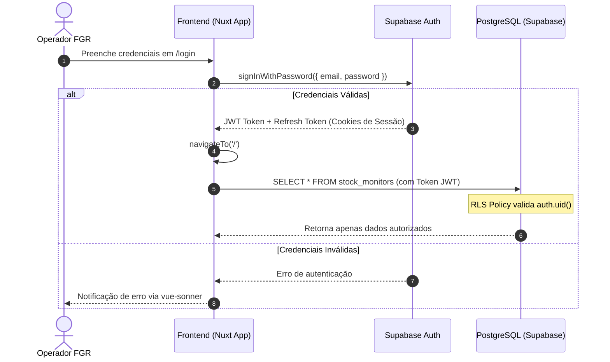
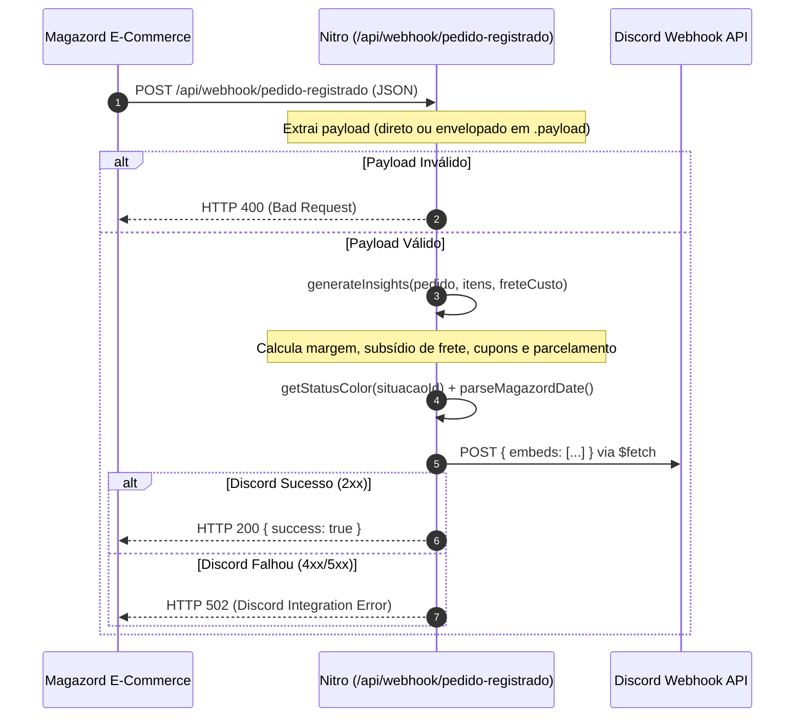

# Arquitetura do Sistema — fgr-webservice

> Este documento descreve o modelo arquitetural, a divisão de responsabilidades, as decisões de renderização (SSR vs CSR) e o fluxo de dados do `fgr-webservice`.

---

## 1. Visão Geral da Arquitetura

O **`fgr-webservice`** é implementado como um monorail fullstack baseado em **Nuxt 4** com o motor de servidor **Nitro**. Ele une em uma única base de código:

1. **Frontend Administrativo:** Interface reativa para gestão operacional e monitoramento de estoque da FGR Sports.
2. **Landing pages públicas:** Captação de leads em `/lp/[slug]`, com armazenamento no Supabase e custom elements para incorporação.
3. **Backend Serverless (Nitro):** Endpoints HTTP especializados em processamento de webhooks, captação de leads e execução de tarefas agendadas.

```mermaid
flowchart TD
    subgraph Clientes ["Camada de Clientes & Externos"]
        BrowserStore["Loja Virtual Magazord (Navegador do Comprador)"]
        BrowserAdmin["Navegador (Operador FGR)"]
        MagazordAPI["Plataforma Magazord (Servidores)"]
        VercelCron["Vercel Cron Scheduler"]
    end

    subgraph NuxtApp ["fgr-webservice (Nuxt 4 / Nitro)"]
        subgraph Front ["Camada Frontend (Vue 3.5 + Tailwind v4)"]
            PublicScript["public/track-shipping-request.js"]
            LandingPage["app/pages/lp/[slug].vue"]
            LeadForm["app/components/landing/LeadCaptureForm.vue"]
            WebComponent["web-components/redes-de-futebol.ts"]
            LoginView["app/pages/login.vue"]
            InventoryView["app/pages/inventory/monitored-inventory.vue"]
            UIPrims["app/components/ui (shadcn / Reka UI)"]
            TanStackTable["@tanstack/vue-table v9 (features.ts)"]
        end

        subgraph Server ["Camada Backend (Nitro Server Engine)"]
            HealthAPI["server/api/health.get.ts"]
            LeadAPI["server/api/public/landing-leads.post.ts"]
            WebhookNovo["server/api/webhook/pedido-registrado.post.ts"]
            WebhookStatus["server/api/webhook/pedido-alterado.post.ts"]
            CronStock["app/server/api/cron/check-stock.ts*"]
            InsightsEngine["Regras de Negócio & Insights (generateInsights)"]
        end

        subgraph Shared ["Camada Compartilhada (shared/)"]
            Schemas["shared/schemas (Zod)"]
            Types["shared/types (Magazord & DB)"]
            Utils["shared/utils (Formatters & Colors)"]
        end
    end

    subgraph ServicosExternos ["Serviços Externos & Persistência"]
        GA4["Google Analytics 4 (DataLayer)"]
        DiscordVendas["Discord Webhook (Canal Novos Pedidos)"]
        DiscordStatus["Discord Webhook (Canal Atualizações)"]
        DiscordEstoque["Discord Webhook (Canal Alertas de Estoque)"]
        SupabaseAuth["Supabase Auth (Sessões / JWT)"]
        SupabaseDB["Supabase Postgres (stock_monitors + RLS)"]
        LeadsDB["Supabase Postgres (landing_page_leads + RLS)"]
        MagazordCatalog["API de Estoque Magazord (Consulta de SKU)"]
        WhatsApp["WhatsApp FGR Sports"]
    end

    %% Conexões de Clientes
    BrowserStore -->|"Executa script de frete"| PublicScript
    PublicScript -->|"Push calculate_shipping"| GA4
    BrowserAdmin -->|"Acessa Painel"| LoginView
    BrowserAdmin -->|"Gerencia Estoque"| InventoryView
    BrowserStore -->|"Acessa /lp/redes-de-futebol"| LandingPage
    WebComponent -->|"iframe isolado da landing"| LandingPage
    LandingPage --> LeadForm
    LeadForm -->|"POST /api/public/landing-leads"| LeadAPI
    LeadAPI -->|"Service role no servidor"| LeadsDB
    LeadForm -->|"Após salvar com sucesso"| WhatsApp

    %% Webhooks e Crons
    MagazordAPI -->|"POST /api/webhook/pedido-registrado"| WebhookNovo
    MagazordAPI -->|"POST /api/webhook/pedido-alterado"| WebhookStatus
    VercelCron -->|"GET /api/cron/check-stock"| CronStock

    %% Processamento Nitro
    WebhookNovo -->|"Processa cálculos"| InsightsEngine
    InsightsEngine -->|"Embed formatado"| DiscordVendas
    WebhookStatus -->|"Embed de status"| DiscordStatus
    CronStock -->|"serverSupabaseServiceRole"| SupabaseDB
    CronStock -->|"Consulta saldo de SKU"| MagazordCatalog
    CronStock -->|"Alerta de estoque baixo"| DiscordEstoque

    %% Autenticação e Dados Frontend
    LoginView -->|"signInWithPassword"| SupabaseAuth
    InventoryView -->|"Consome schemas"| Schemas
    InventoryView -->|"Monta tabelas"| TanStackTable
```

---

## 2. Camadas do Sistema

### Identidade visual

- **Nicho:** esporte e equipamentos esportivos.
- **Cores FGR:** azul primário `#035096` e laranja de destaque `#fe3e00`, disponibilizados como tokens `--fgr-blue` e `--fgr-orange` e conectados aos tokens semânticos do Tailwind.
- **Assinatura da marca:** SVG horizontal oficial da FGR Sports carregado da CDN Magazord nas áreas públicas da landing.
- As rotas `/lp/*` são excluídas do redirecionamento global de autenticação do módulo Supabase; as rotas administrativas permanecem protegidas.

### 2.1 Camada de Apresentação (Frontend)

- **Localização:** `app/`
- **Framework:** Vue 3.5 com Composition API (`<script setup lang="ts">`).
- **Design System:** Tailwind CSS v4 baseado em tokens CSS (`app/assets/css/tailwind.css`), garantindo consistência em modo claro e escuro.
- **Componentes:**
  - Componentes de layout e navegação: [`AppSidebar.vue`](file:///c:/Users/marke/OneDrive/Desktop/ale/fgr-webservice/app/components/AppSidebar.vue), [`NavUser.vue`](file:///c:/Users/marke/OneDrive/Desktop/ale/fgr-webservice/app/components/NavUser.vue), [`ResponsiveModal.vue`](file:///c:/Users/marke/OneDrive/Desktop/ale/fgr-webservice/app/components/ResponsiveModal.vue).
  - Primitivas shadcn-nuxt/Reka UI: `app/components/ui/` (botões, inputs, cards, diálogos, tabelas).
  - Componentes de domínio: `app/components/monitored-inventory/`.

### 2.2 Camada de Servidor (Backend / Nitro)

- **Localização:** `server/` (e transitoriamente `app/server/`).
- **Motor:** Nitro, compilado para funções serverless otimizadas para deploy na Vercel.
- **Responsabilidades:**
  - Validação e ingestão de webhooks da Magazord.
  - Geração de regras e insights de venda.
  - Formatação e despacho de embeds para a API do Discord.
  - Execução de tarefas agendadas de auditoria de estoque (Crons).
  - Health check da infraestrutura.

### 2.3 Camada Compartilhada (`shared/`)

- **Localização:** `shared/`
- **Isomorfismo:** Arquivos nesta pasta são auto-importados tanto no frontend Nuxt quanto no backend Nitro.
- **Subdivisões:**
  - `shared/schemas/`: Contratos de validação com Zod (`inventory-monitoring.schema.ts`, `login.schema.ts`).
  - `shared/types/`: Tipagens canônicas de domínio (`magazord.ts`, `database.types.ts`).
  - `shared/utils/`: Funções puras de formatação monetária, parsing de data e mapeamento de cores (`magazord.ts`).

### 2.4 Landing pages públicas e Web Component

- **Rota:** `app/pages/lp/[slug].vue`; a landing inicial usa o slug `redes-de-futebol`.
- **Formulário:** `app/components/landing/LeadCaptureForm.vue`, compartilhado entre a página pública e sua versão incorporável.
- **API:** `POST /api/public/landing-leads` valida os campos novamente e grava o lead usando a service role exclusivamente no servidor.
- **Persistência:** `public.landing_page_leads`, com RLS habilitado, leitura apenas por usuários com `app_metadata.role = 'admin'` e sem escrita direta pelo navegador.
- **Web Component:** `web-components/redes-de-futebol.ts` gera `public/web-components/redes-de-futebol.js` durante o build. O elemento `<redes-de-futebol>` incorpora a landing em iframe; o atributo `base-url` permite definir a origem do serviço.
- **Conversão:** o navegador só segue para o WhatsApp após confirmação da gravação do lead.

---

## 3. Decisões de Renderização: SSR vs CSR

O projeto adota uma abordagem híbrida inteligente configurada para equilibrar SEO, performance e segurança:

| Rota / Recurso                     | Modo de Renderização            | Justificativa                                                                                                                                |
| :--------------------------------- | :------------------------------ | :------------------------------------------------------------------------------------------------------------------------------------------- |
| `/login`                           | **SSR + Hidratação CSR**        | Entrega rápida da casca HTML (`layout: 'no-sidebar'`), com hidratação client-side para o formulário VeeValidate e autenticação com Supabase. |
| `/` (Dashboard)                    | **CSR Protegido**               | Interface administrativa restrita que depende da sessão do usuário autenticado.                                                              |
| `/lp/[slug]`                       | **Pública + hidratação CSR**    | Landing indexável e formulário de lead, renderizado sem autenticação e incorporável por Web Component.                                       |
| `/inventory/monitored-inventory`   | **CSR Protegido**               | Renderização dinâmica do `@tanstack/vue-table` e interação com modais de cadastro de produtos.                                               |
| `/api/*`                           | **Serverless (Nitro)**          | Execução 100% no servidor, sem renderização visual, atuando como API REST e webhook receiver.                                                |
| `public/track-shipping-request.js` | **Script Client-Side Estático** | Injetado no checkout do e-commerce para interceptação de requisições XHR/fetch.                                                              |

---

## 4. Autenticação, Autorização e Segurança

### Regras de Acesso ao Banco de Dados

1. **Frontend:** Todo acesso utiliza o cliente anônimo com o token JWT da sessão ativa (`useSupabaseClient()`). As políticas de RLS garantem que nenhum usuário veja ou altere dados de outro tenant/usuário.
2. **Cron Jobs & Webhooks:** Utilizam `serverSupabaseServiceRole(event)` exclusivamente para operações automatizadas que não possuem contexto de usuário logado (ex: ler todos os monitores ativos para auditoria de estoque). **Essa chave nunca trafega para o navegador.**

---

## 5. Fluxo de Processamento de Webhooks (Magazord ➔ Discord)

